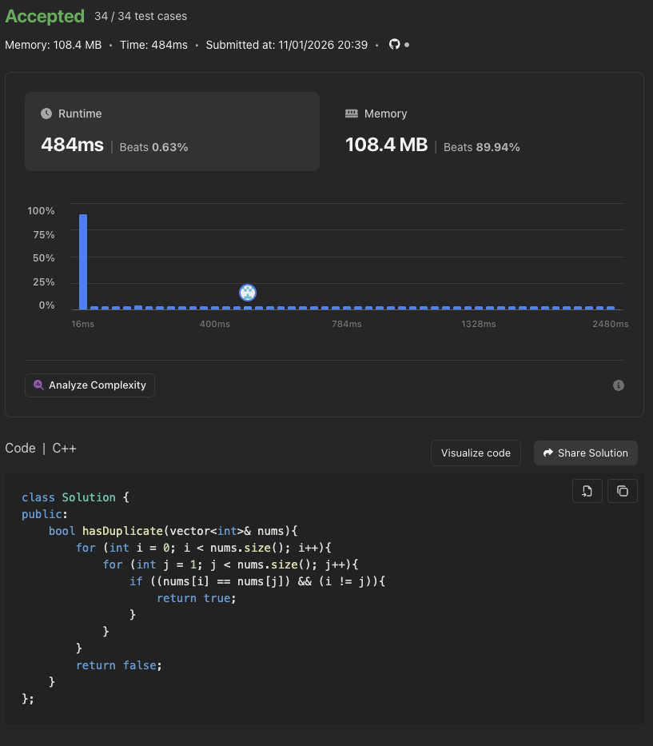
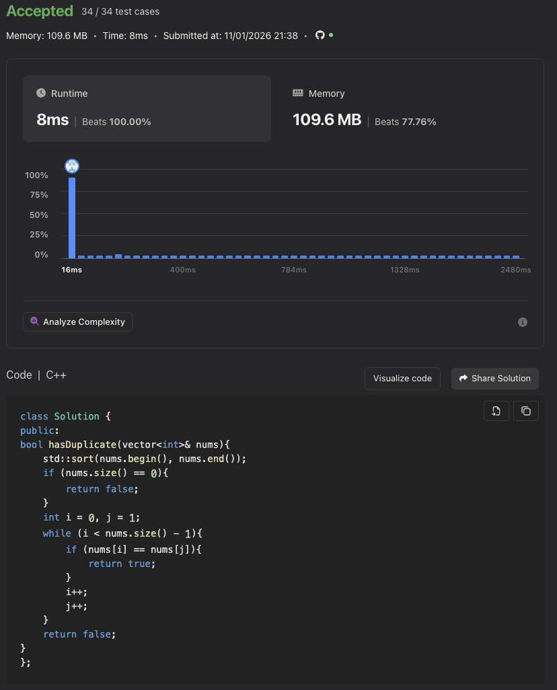

# Contains Duplicate — Learning Notes

The goal of this problem is to determine whether a collection of integers contains any repeated values. This exercise helped me move from a straightforward implementation to a more efficient solution while learning about C++ containers, standard library algorithms, and edge cases.

## Initial Approach: Naïve Comparison

My first attempt focused on implementing the basic idea without planning for edge cases or optimizations. I initially used C-style arrays before learning how to work with `std::vector<int>` for this problem. The accepted naïve implementation shown below uses a vector.

The naïve solution uses nested loops to compare elements and returns `true` when two different indices contain the same value. It works, but it repeats comparisons and can perform a quadratic number of checks when no duplicates are found.

- **Worst-case time complexity:** O(n²), where n is the number of elements.
- **Auxiliary space complexity:** O(1), because the algorithm only stores loop indices and does not allocate another collection.

This approach taught me that a correct solution can still be inefficient, especially as the input grows.

## Improved Approach: Sort and Compare Neighbors

With a better understanding of the problem, I realized that sorting places equal values next to each other. After sorting, I only need to compare adjacent elements to detect a duplicate.

I first spent time writing my own sorting function. After reading the C++ documentation, I learned that the standard library already provides `std::sort`. Reusing that algorithm simplified the solution and avoided unnecessary implementation work. `std::sort` is declared in `<algorithm>` and can sort a vector through its iterators:

```cpp
std::sort(nums.begin(), nums.end());
```

- **Worst-case time complexity:** O(n log n) for sorting, followed by an O(n) scan, giving O(n log n) overall.
- **Auxiliary space complexity:** Typically O(log n) for the sorting implementation's stack; the adjacent-element scan itself uses O(1) space. The exact sorting space usage depends on the standard library implementation.
- **Trade-off:** Sorting modifies the original vector because it is passed by reference. Preserving the original order by sorting a copy would require O(n) additional space.

## Edge Case: Empty Vector

An empty input exposed a heap-buffer-overflow error in my sorted implementation. The problem was the loop condition:

```cpp
while (i < nums.size() - 1)
```

`nums.size()` returns an unsigned value. When the vector is empty, subtracting 1 wraps around to a very large value instead of producing -1. The loop then attempts to access elements that do not exist.

I fixed this by checking for an empty vector and returning `false` before reaching the loop:

```cpp
if (nums.empty()) {
    return false;
}
```

Sorting an empty vector is valid; the invalid element access caused the error. This taught me to consider empty and single-element inputs early and to be careful when subtracting from unsigned sizes. A vector with fewer than two elements cannot contain duplicates.

## Complexity and Measured Performance

Both screenshots show accepted submissions passing **34 out of 34 test cases**.

| Metric | Naïve implementation | Sorted implementation |
| --- | --- | --- |
| Worst-case time complexity | O(n²) | O(n log n) |
| Auxiliary space complexity | O(1) | Typically O(log n) |
| Reported runtime | 484 ms | 8 ms |
| Runtime percentile | Beats 0.63% | Beats 100.00% |
| Reported memory usage | 108.4 MB | 109.6 MB |
| Memory percentile | Beats 89.94% | Beats 77.76% |

In these runs, sorting reduced runtime by **476 ms**, making the solution **60.5 times faster** (about a **98.35% reduction** in runtime). Reported memory usage increased by **1.2 MB**, or about **1.1%**.

Compared with other submissions in the platform's benchmark population, the naïve solution's runtime beat only 0.63%, placing it near the slow end. Its graph shows a large concentration of submissions in the fastest runtime bucket, well to the left of the 484 ms result. The sorted solution moved into that fastest region and received a reported runtime percentile of 100.00%.

For memory, the naïve solution ranked better: it beat 89.94% of submissions, compared with 77.76% for the sorted solution. This illustrates the observed trade-off: a substantial runtime improvement with a small increase in measured memory.

These percentiles describe the platform's comparison population at submission time, not every implementation worldwide. A displayed 100.00% does not establish a unique fastest solution. Runtime and memory measurements can vary between runs, and reported memory includes more than the algorithm's auxiliary storage. Big-O analysis describes how resource use scales with input size; these measurements describe the particular benchmark runs.

### Naïve Submission



### Sorted Submission



## Key Takeaways

- Start with a simple solution, then analyze where it repeats work.
- Use C++ containers such as `std::vector` and learn the standard algorithms available for them.
- Check whether a standard library function solves the problem before writing a custom implementation.
- Test empty inputs, single-element inputs, duplicates, and inputs without duplicates.
- Understand unsigned arithmetic before using expressions such as `size() - 1`.
- Compare both time and space costs, and distinguish asymptotic complexity from measured performance.
