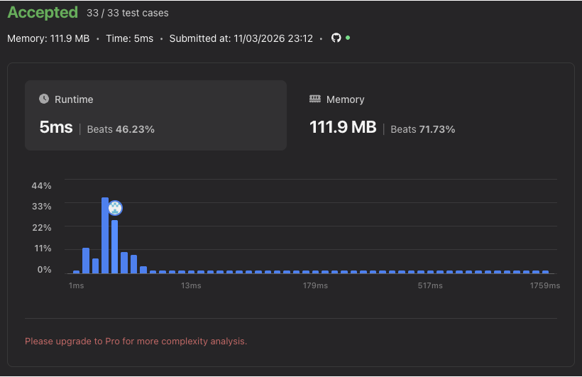
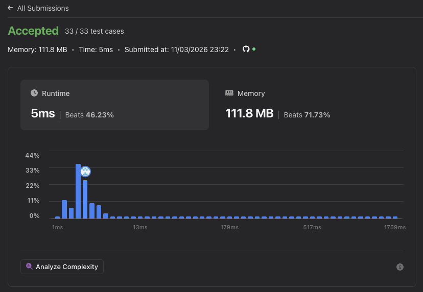

# Two Sum — Learning Notes

The goal of this problem is to find the indices of two different elements whose values add up to a target. I started with nested loops to search for a matching pair, then introduced a two-pointer implementation adapted from a Two Difference question, followed by a hash-map implementation.

## Initial Approach: Naïve Pair Comparison

The function takes `nums` by reference and a target integer. An outer loop visits each index `i`, and an inner loop visits every index `j`, starting at zero each time.

The condition checks both the sum and whether the indices are different:

```cpp
if ((nums[i] + nums[j] == target) && (i !=j))
```

The `i != j` check prevents using the same element twice. Two elements with equal values can still form a pair when they occupy different indices.

When a pair matches, the function creates a two-element output vector, stores `i` and `j`, and returns immediately. This returns indices rather than the values themselves. Because both loops start at zero, the search can examine both orders of a pair before finding a result. The input vector is not modified.

- **Worst-case time complexity:** O(n²), where n is the number of input elements.
- **Auxiliary space complexity:** O(1). The loop variables and two-element result use a fixed amount of storage, and the input is passed by reference.

## Implementation Progression

When first inspected, the nested-loop function was enclosed in a block comment, had no return after the loops, and `main()` only returned zero.

At the next inspection, the same function was active, and `return {};` had been added after the loops. If the search finishes without finding a pair, this returns an empty vector. `main()` also gained two example calls and prints each returned index on its own line, with a blank line between the examples.

The source retains a comment stating a recommended O(n) time and O(n) space target. The implemented nested-loop approach is separately labeled O(n²) time and O(1) space. No additional reason for choosing this approach has been supplied.

## Subsequent Approach: Two Pointers with Original Indices

I commented out the nested-loop version and added a two-pointer implementation. The source comment identifies this as adapted from a Two Difference question into Two Sum.

The function first builds `vector<pair<int, int>> arr`, storing each input value alongside its original index as `{nums[k], k}`. It then calls:

```cpp
sort(arr.begin(), arr.end());
```

Two indices start at opposite ends of `arr`: `i` at zero and `j` at `arr.size() - 1`. While `i < j`, the function compares `arr[i].first + arr[j].first` with the target. An exact match returns the stored original indices. A sum below the target increments `i`; a sum above the target decrements `j`. If the pointers meet without a match, the function returns an empty vector.

### Sorting and Traversal Behavior

The first two-pointer version sorted `nums` while traversing the separate, unsorted `arr`. In the latest version, I changed the sorting call to operate on `arr` itself. The pairs are ordered by value, with original indices breaking ties. The pointer traversal now reads the sorted collection, while each pair still carries its original input index. The input vector is no longer modified.

With values in sorted order, a sum below the target moves the left pointer toward larger values; a sum above the target moves the right pointer toward smaller values. The `i < j` condition keeps the selected elements distinct.

The return expression now uses `min` and `max` on the stored indices, returning the smaller original index first regardless of the pair's positions after sorting.

### Time and Space Complexity

- **Pair construction:** O(n) amortized time to copy the n values and original indices into `arr`.
- **Sorting:** O(n log n) time to sort the pairs.
- **Two-pointer traversal:** O(n) worst-case time, because each iteration moves one pointer inward.
- **Overall worst-case time complexity:** **O(n log n)**. Sorting dominates the O(n) construction and traversal. The constant-time `min` and `max` calls do not change this bound.
- **Auxiliary space complexity:** **O(n)** for the pairs. Typical O(log n) sorting stack storage does not change the overall O(n) bound.

## Subsequent Approach: Hash Map of Previously Seen Values

I added a third implementation under the comment `using hashmaps`. It creates an `unordered_map<int, int>` named `output_map`, mapping each previously visited value to its index.

For each index `i`, the function computes `difference = target - nums[i]`. It searches the map for that difference. When found, it returns the previously stored index followed by `i`. Otherwise, it stores the current value and index with `output_map[nums[i]] = i` and continues. A completed search without a match returns an empty vector.

The lookup happens before inserting the current element, so a match uses an earlier, distinct index. Repeated values overwrite their earlier stored index if no pair has yet been returned. This implementation reads the input without sorting or modifying it. No additional motivation for choosing the hash-map approach has been supplied.

### Time and Space Complexity

- **Average time complexity:** **O(n)**. The loop visits each element once, with average O(1) hash-map lookup and insertion operations. The extra lookup through `output_map[difference]` on a match does not change the overall bound.
- **Worst-case time complexity:** **O(n²)** if hash collisions cause individual operations to take O(n) time.
- **Auxiliary space complexity:** **O(n)** for the previously seen values and their indices.

## Current Source Organization

The naïve implementation has been uncommented, and all three implementations now appear as active definitions with the same `twoSum(vector<int>& nums, int target)` signature. This constitutes function redefinition in a single translation unit. The file's explicit includes remain `<iostream>` and `<algorithm>`; the new implementation uses `unordered_map` without an explicit `<unordered_map>` include. These are observations of the saved source, separate from the accepted submissions shown below.

## Example Inputs

The first example uses `{3,4,5,6}` with target `7`. Both the earlier nested-loop traversal and the current pointer traversal find indices `0` and `1`, corresponding to `3 + 4`.

The second example uses `{4,5,6}` with target `10`. It finds indices `0` and `2`, corresponding to `4 + 6`. The earlier implementation excludes using the middle element twice through `i != j`; the current implementation keeps its two positions distinct through `i < j`. Both example vectors are already sorted, so their copied pairs are ordered as well.

Considered individually, all three implementations return the same indices for these examples. In the hash-map version, the first example finds the stored `3` when visiting `4`; the second finds the stored `4` when visiting `6`.

For each implementation considered separately, the expected output from the example calls is:

```text
0
1

0
2
```

This output is inferred from the code; it was not produced by a local execution during documentation.

## Complexity and Measured Performance

All three submission screenshots show **accepted solutions passing 33 out of 33 test cases**.

| Metric | Naïve implementation | Two-pointer implementation | Hash-map implementation |
| --- | --- | --- | --- |
| Average hash-map time bound | — | — | O(n) |
| Worst-case time complexity | O(n²) | O(n log n) | O(n²) |
| Auxiliary space complexity | O(1) | O(n) | O(n) |
| Reported runtime | 6 ms | 5 ms | 5 ms |
| Runtime percentile | Beats 21.75% | Beats 46.23% | Beats 46.23% |
| Reported memory usage | 109.2 MB | 111.9 MB | 111.8 MB |
| Memory percentile | Beats 88.96% | Beats 71.73% | Beats 71.73% |

In these submissions, runtime decreased by **1 ms**, approximately **16.67%**, while reported memory increased by **2.7 MB**, approximately **2.47%**. The runtime percentile rose from 21.75% to 46.23%; the memory percentile fell from 88.96% to 71.73%.

The measured results show a smaller runtime and larger memory usage for the two-pointer submission. The complexity analysis describes scaling with input size, while these timings describe the particular benchmark runs.

The hash-map submission reports the same 5 ms runtime and percentiles as the two-pointer submission, with 0.1 MB less reported memory. Relative to the naïve submission, its reported memory is 2.6 MB higher and runtime is 1 ms lower.

These measurements describe the supplied submissions. The reported memory includes more than the function's auxiliary storage, and the percentiles describe the comparison population at submission time.

### Naïve Submission


### Two-Pointer Submission



### Hash-Map Submission



## Key Observations

- The nested loops search pairs of indices and return the first matching pair in their traversal order.
- The distinct-index condition prevents reusing one element.
- The two-pointer implementation sorts copied value/index pairs and leaves the input unchanged.
- Storing original indices alongside sorted values preserves the positions needed for the return value.
- The returned indices are ordered using `min` and `max`.
- Sorting determines the overall O(n log n) time complexity; the pointer traversal itself is O(n).
- The added empty-vector return handles a completed search with no matching pair.
- The hash-map version checks for a previously seen complement before storing the current element.
- Hash-map operations give average O(n) total time, with O(n) auxiliary storage and an O(n²) collision worst case.
- All three supplied screenshots record accepted submissions passing all 33 tests.
